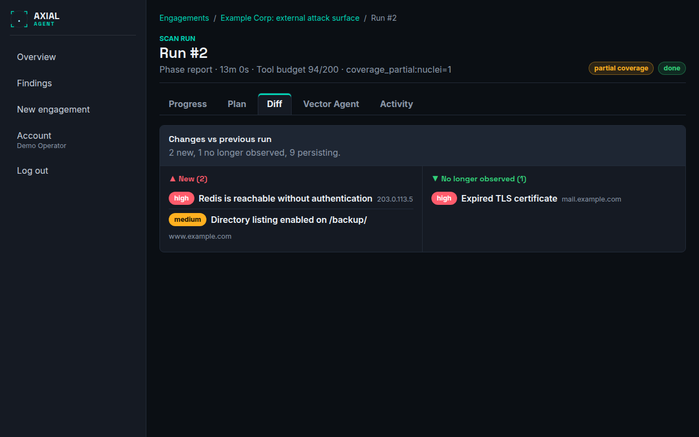

# Compare runs

**Who this is for:** operators who scan the same engagement more than once, for example to confirm that fixes worked.
**After this page you can:** read the difference between two runs, and judge when "no longer seen" really means "fixed".

<!-- ui-labels: Diff | Changes vs previous run | Nothing new. | Nothing resolved. | No longer observed | Runs & reports | partial coverage | reduced coverage | Plan | Resolved | Hosts and ports | New hosts | Newly open ports | Changed services | Hosts no longer seen | Ports no longer open -->

## How findings are matched

Findings belong to the engagement, not to a single run, and each has a fingerprint. When you scan again, a finding that is seen again is **updated**, not duplicated: its *Last seen* moves forward and its history stays. That is what lets Axial tell you what changed.

## The Diff tab

Open a run and choose **Diff**. Under **Changes vs previous run** it shows:

| Part | Meaning |
|---|---|
| **New** | findings this run saw that the previous run did not |
| **No longer observed** | findings the previous run saw that this one did not |
| persisting | how many findings were seen in both; only the count is shown |

A summary line gives the counts, for example *3 new, 1 no longer observed, 12 persisting*. The first run of an engagement has no previous run: the tab then says *No previous run to compare — this run is the baseline.* An empty list reads *Nothing new.* or *Nothing resolved.* The same comparison is the **risk overview** of the PDF report; see [Reports](reports.md).

## Hosts and ports

Below the findings, **Hosts and ports** shows what changed in the attack surface itself since the previous full run. It is the same previous run the findings comparison uses, and the panel links to it.

| Part | Meaning |
|---|---|
| **New hosts** | in-scope hosts this run saw that the previous run did not. A host the hold policy has not released says so |
| **Newly open ports** | ports with a service this run found and the previous run did not, with the product it identified |
| **Changed services** | the same port, now another product or version |
| **Hosts no longer seen** | hosts the previous run saw and this one did not |
| **Ports no longer open** | ports the previous run found and this one did not |

It works the same for a test and for a monitor, because every run that did not fail stores what it saw. Two cases are never read as "gone":

- A run with **reduced coverage**, or one limited to some hosts, does not say that a host or port is gone, because that may only mean it was not looked at. The two "no longer" groups are then not shown, and the panel says why. What is new or changed is real.
- A run, or the run it would be compared with, that has no stored hosts and ports (it finished before they were stored for every engagement) reads *not recorded*, not "everything is gone". The next run can be compared.

A monitor also lists these differences as **Changes** on its engagement page; see [Monitor an attack surface](monitor-an-attack-surface.md).

## When "no longer observed" means fixed

Not always. A finding that is *not observed* in a run was either fixed, or not looked for properly. Before you read it as a fix, check:

1. **Coverage.** Does the run carry **partial coverage** or **reduced coverage**? Then some checks stopped at their time budget or a core tool never succeeded, and a missing finding may only be a missing look. Compare the **Plan** tab of both runs: is the check that found it before *complete* this time?
2. **Scope and tools.** Did the scope, the tool grants or the scan depth change between the two runs? A tool switched off, or **Standard** instead of **Thorough**, finds less.
3. **The target.** Is the host still reachable and answering? A host that is down looks clean.

Only when the check ran completely and found nothing is it reasonable to mark the finding **Resolved**. If it comes back later, Axial reopens it as a regression; see [Triage findings](triage-findings.md).

## A routine for verifying fixes

1. Fix the problem on the target.
2. Start a new run on the same engagement, with the same scan depth as before.
3. Open the run's **Plan** and confirm the relevant check is *complete*.
4. Open **Diff** and confirm the finding is under *no longer observed*.
5. Mark the finding **Resolved** and, if you report to a client, generate a new report.
