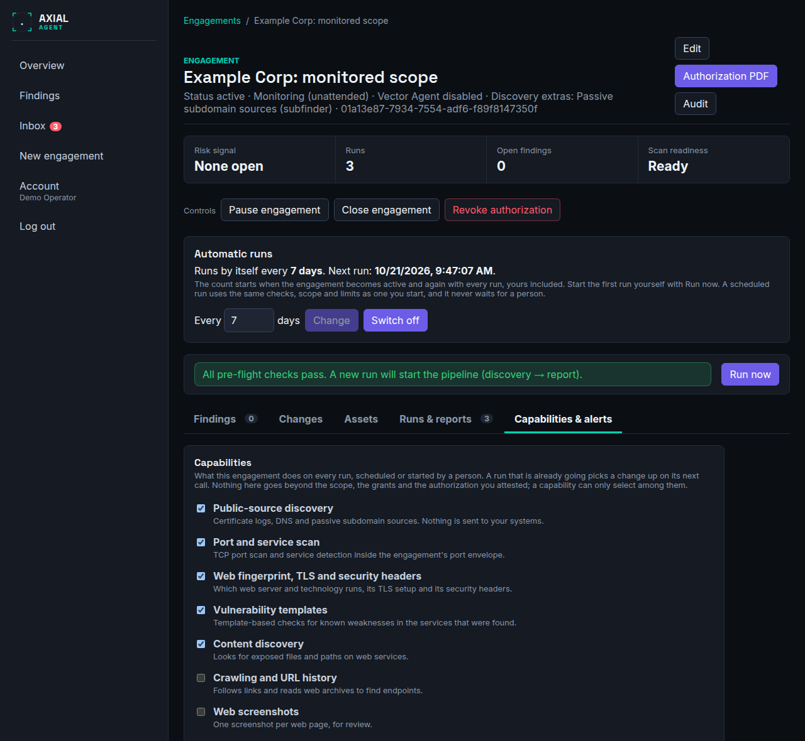
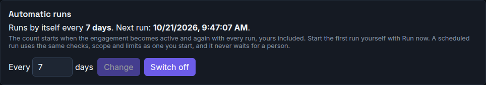
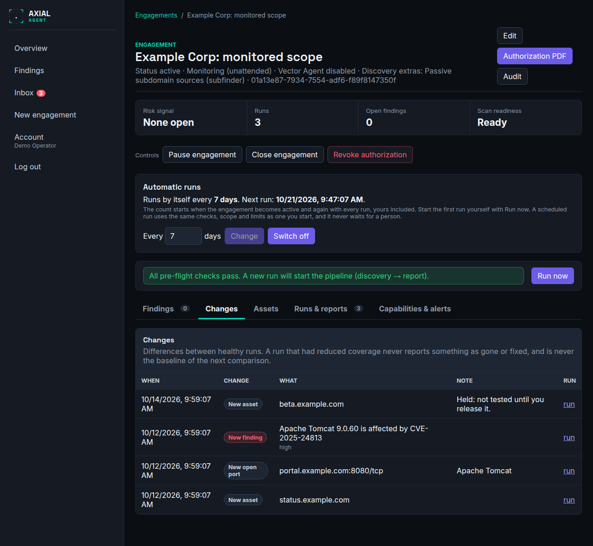

# Monitor an attack surface

**Who this is for:** operators who want Axial to watch a scope again and again and say what changed, without anyone at the screen.
**After this page you can:** set up a monitoring engagement, decide what it does on every run, read what it reports, and know what it will not do by itself.

<!-- ui-labels: Monitor an attack surface | Test a target | What to monitor | Capabilities | Alerts | Authorize | Activate monitoring | Run now | Changes | Capabilities & alerts | Save capabilities | Add webhook | Inbox | Pause engagement | Resume engagement | Close engagement | Revoke authorization | Monitoring defaults | Release all | Automatic runs | Switch on | Switch off | Change -->

A *monitoring* engagement is one you set up once and let run. It is the other of the two uses of Axial; the first is a *test* that a person starts and decides along the way. Read [Concepts](../concepts.md#operating-modes) for the difference. What they share is everything that keeps a scan safe: the scope, the deny rules, the authorization, the window and the audit log.

## What a monitor does and does not do

| It does | It does not |
|---|---|
| Run the same checks every time, so two runs can be compared | Wait for a person during a run. Nothing pauses on a popup or on a review |
| Tell you what changed: a new host, a new open port, a new version, a new or fixed finding | Make a request that needs a person's approval. Such a call is not made; it is listed in the inbox as a suggestion |
| Keep a newly found host out of the testing until you release it, if you choose so | Test credentials or exploit anything. Those categories cannot be granted to a monitor |
| Say when it is quiet, degraded or about to need a review | Report something as fixed from a run that did not look at everything |

## Set it up

Choose **New engagement**, then **Monitor an attack surface**. The wizard has four steps.

1. **What to monitor.** A name, an emergency contact, the dates between which monitoring is authorized, and the scope. Add an *allow* row for each domain, address or range, and tick **I am authorized to test this**. A *deny* row always wins. The default period is a year: a monitoring authorization is standing and is reviewed once a year.
2. **Capabilities.** What it does on every run (below), the scan depth, and what happens with a new host.
3. **Alerts.** Where to send a message when something changes.
4. **Authorize.** What will run without anyone watching, and what can never happen. Download the authorization document for signature, then **Activate monitoring**.

After activation, choose **Run now**. The first healthy run is the baseline: it reports nothing as changed, because there is nothing yet to compare with. The next run shows what is different.

## Capabilities

A capability is a function of the scanner that this engagement switches on or off **once**. It applies to every run, never to a single one, and a run that is already going picks a change up on its next call.

| Capability | What it is |
|---|---|
| Public-source discovery | Certificate logs, DNS and passive subdomain sources. Nothing is sent to your systems |
| Port and service scan | TCP port scan and service detection inside the engagement's port limits |
| Web fingerprint, TLS and security headers | Which web server and technology runs, its TLS setup and its headers |
| Vulnerability templates | Template-based checks for known weaknesses in what was found |
| Content discovery | Looks for exposed files and paths on web services |
| Crawling and URL history, Web screenshots, Out-of-band interaction testing | The three discovery extras; off by default |
| Vector Agent | An AI model proposes further checks. Off by default. Whatever it proposes that would need a person's decision is not made but kept as a suggestion |

A capability can only select among what the scope, the tool grants and your attested authorization already allow. It never goes beyond them.

**Scan depth.** *Passive* uses public sources only and sends nothing to your systems. *Light* checks fingerprint, TLS, security headers and takeover only, which is cheap enough to run daily. *Standard* is the usual depth. *Thorough* runs all non-intrusive web templates, whether or not their product was identified, plus a deep content sweep, and takes much longer.

**New hosts.** *Test as soon as the scope covers them* is the usual behavior. *Hold until I release them* inventories a new host and tells you, but does not test it until you release it in the [inbox](../reference/inbox.md). A host you wrote into the scope yourself is never held, and neither is one that was already there before you switched the policy on. For a customer's systems, whose DNS you may not know well, hold is the safer choice.

**Widening after activation.** Turning a capability on, going to a deeper scan depth or switching hold off after activation asks you to confirm, because it widens what runs unattended. It is refused while a run is active. Narrowing is always possible.

The administrator sets what a *new* monitoring engagement starts with under **Monitoring defaults** in the admin settings. The values are copied when the engagement is created; changing them later does not change an engagement that already exists, because a customer may already have signed for what it does.

## Automatic runs

A monitor can run by itself every so many days. Set the number on the **Automatic runs** panel of the engagement page, or in step 2 of the wizard (the wizard starts with 7). **Switch on** starts it, **Change** alters the number of days, and **Switch off** goes back to starting every run yourself with **Run now**. It is whole days, from 1 to 90, and there is no time of day: the point is that the interval is simple.

How the count works:

- The next run is due one interval after the **latest** of: when you set the interval, when the engagement last became active (activation, or **Resume engagement**), and when the last run started, whoever started it. A **Run now** therefore restarts the count.
- Setting the interval never starts a run at once. Start the first run yourself with **Run now**; it is the baseline.
- A scheduled run is exactly a run you could start: the same readiness check, the same scope, grants and limits, and it never waits for a person. Its start is recorded in the audit log with the schedule as the actor.

When a due run does not start, the panel says why, the reason is recorded, and the run starts by itself as soon as the cause is gone:

| Reason | What it means |
|---|---|
| The engagement is paused (or not active) | Resume it. Nothing runs while it is paused, draft, completed or revoked |
| The authorized window is not open | The test window has not begun or has ended |
| The authorization review date has passed | Review the authorization to continue; an item appears in the inbox |
| A run is still going | The next one starts after it; runs of one engagement never overlap |
| Waiting for capacity | Other scheduled runs are using the installation's capacity (one at a time unless the administrator raised the limit) |
| Not ready to scan | A readiness blocker, such as scope without an attested authorization; an item appears in the inbox |

A failed run is not retried by the schedule: the next run is due one interval after it started, or when you run it yourself. If a monitor has no healthy run for twice its interval, the inbox shows it and an alert is sent.

## Read what it reports

The engagement page shows **What changed** above its tabs, and the **Changes** tab lists everything: a new or missing host, an opened or closed port, a changed service version, a new, fixed or returned finding. Three rules make it trustworthy:

- The comparison is always with the last **healthy** run. A run that was cut short, or whose important tools failed, is marked *reduced coverage* and is never the comparison for the next one.
- A short run never reports something as gone or fixed. It can only say what it found.
- A finding is reported as fixed only after two healthy runs in a row did not see it, so a check that merely flickers does not look like a fix.

A finding that you have accepted as a risk or marked a false positive does not alert again.

## Alerts

Add a signed webhook on the **Capabilities & alerts** tab, under **Alerts**. The address must be a public https address; an internal or private address is refused. If you give a signing secret, every message carries an HMAC-SHA256 signature so the receiver can check where it came from. The secret is never shown again.

A message names the engagement, what changed and a link to the console. It contains no evidence, no request or response and no credential. Critical and known-exploited findings are sent at once; the rest as a daily digest. Delivery is retried with growing pauses; a failed delivery is shown with its error and never affects a run.

## The inbox

Everything a monitor could not decide for itself ends up in the [inbox](../reference/inbox.md): a held host, a suggested manual test, a run with reduced coverage, a run that did not finish, a monitor that has gone quiet and an authorization that needs review. Open items are counted next to **Inbox** in the navigation.

## Stop it, or end it

On the engagement page:

- **Pause engagement** stops the active run and makes the gateway deny every call until you choose **Resume engagement**. Use it when a customer calls.
- **Close engagement** ends a finished engagement. It cannot be resumed; its findings, runs and reports stay.
- **Revoke authorization** is the kill switch. It stops everything now and the engagement can never scan again.

Only the engagement's owner and administrators can use these.

## What is not part of a monitor in this version

- **A time of day, windows or several schedules.** There is one interval per engagement, counted from the last run. A run starts when it is due, not at a chosen hour.
- **Requests that change data.** A request that could change data on a target is not made by a monitor, and the agent's proposal for one is kept as a suggestion. Per-command approval remains the rule for a test.
- **E-mail.** Alerts go to a webhook.

See also [Safety, legal and limits](../safety-legal-limits.md).
