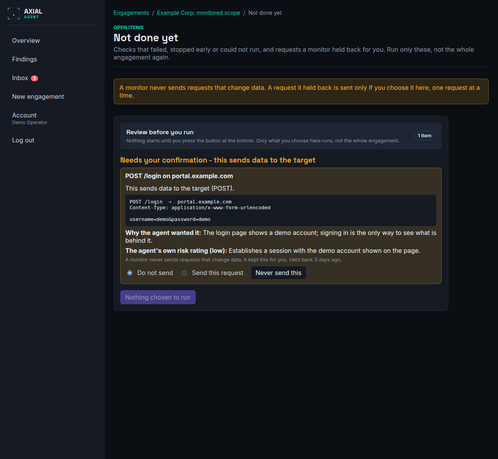

# Retest and run only what is open

**Who this is for:** operators who own an engagement, especially a monitor that held something back for them.
**After this page you can:** confirm that a fix worked without scanning everything again, run the checks a run left unfinished, and decide, one request at a time, whether to send a request a monitor would not send.

<!-- ui-labels: Not done yet | Review before you run | Retest this finding | Run this step again | Runs without asking (read-only) | Needs your confirmation - this sends data to the target | Do not send | Send this request | Do not run | Run this check | Never send this | Too old to send | Held back for you | Cancel -->

## The idea

A full run tests the whole engagement. Often you need much less: one finding to confirm as fixed, a check that failed, or a request that a monitor could not make because nobody was there to say yes. For these, Axial runs **only what you choose**, after it has shown you exactly what that is.

There are three ways in, and all three open the same step, **Review before you run**. Nothing starts before you press its button at the bottom.

| You want to | Where |
|---|---|
| Confirm that a finding is fixed | Open the finding on the engagement page or on **Findings** and press **Retest this finding** |
| Run one failed or skipped check again | On the **Plan** tab of a run, press **Run this step again** on its row |
| See and run everything a run left open, including what a monitor held back | **Not done yet (n)** in the header of the engagement, or the **Held back for you** item in the [inbox](../reference/inbox.md) |

## What counts as open

The page **Not done yet** lists what the latest results of the engagement leave open:

- a check that **failed** or **stopped at its time limit**;
- a check that was **skipped for a reason you can change**: a name with no DNS address yet, a missing tool grant, a call the Scope Gateway refused, a helper that was not available;
- a check the run **never reached** because it ended early;
- a **request a monitor held back** because it would have needed a person (see below).

Not on the list: a check that completed, a check that does not apply (a redirect-only port, a duplicate site, a service that is not TLS), a check you switched off, and a check a restricted run left out. A check that a later run completed leaves the list.

## Review before you run

The step has up to three groups.

**Runs without asking (read-only).** Checks whose tool needs no approval. They start ticked, because you asked to run them; untick what you do not want.

**Needs your confirmation - this sends data to the target.** A request a monitor held back, and a check whose tool asks for your approval in this engagement. **Nothing here is ticked for you.** Each item has its own choice, **Do not send** (the default) or **Send this request** (for a check: **Do not run** or **Run this check**). There is no way to choose several at once. For a request the step shows what it does in plain words ("sends data to the target (POST)"), the exact method, path and body, why the agent wanted it and the agent's own risk rating, labelled as the agent's opinion, and how long ago it was held back (the body of a request, which may hold a credential, is shown only to the owner and administrators). **Choosing Send this request is your approval of exactly that request**, and of nothing else; it is not sent if the Scope Gateway no longer allows it when it is its turn. A check that needs approval still asks you for each of its calls while it runs. **Never send this** removes a request for good.

**Too old to send.** A request held back longer than the limit (14 days by default) cannot be sent: the page, the session or the data it was made for may have changed. The monitor proposes it again if it still matters.

The button at the bottom says what it will start, for example **Run 2 checks and 1 request that changes data**. Anything you did not choose is not run and stays open.

## What happens during and after the run

A restricted run is an ordinary run that you watch (it is attended). It skips the engagement-wide discovery and uses the hosts you already have, it identifies the services of the chosen hosts again first, and it runs **only the chosen checks**; the other checks of those services are listed on the **Plan** tab as *skipped* with the reason *not in this run*, which is not a failure. It does not run the Vector Agent. A request you chose is sent exactly as you saw it, and the response appears in the run's activity.

When the run ends, every item is one of **done**, **still open** with its reason, or **rejected by you**. A request you chose that could not be sent (the gateway refused it, the confirmation ran out, the run was stopped) is **open again** with the reason; nothing is lost and it is not a failure of the run.

## Retesting a finding

**Retest this finding** runs the check that produced the finding, on its host and port, and nothing else. The finding becomes **Resolved** only when that check **ran to the end** and did not see the finding again. If the check failed, stopped early or did not run, the finding stays open and the audit log says the retest was incomplete.

A finding that no single check produced, for example one the Vector Agent reported, says so on the step, and the retest then runs all checks for that host.

## Monitors

A monitor never sends a request that changes data. When it needs a person for one, it keeps the whole request and puts **Held back for you** in the [inbox](../reference/inbox.md). A run you start from **Not done yet** is the one exception to "a monitor runs unattended": it is attended and restricted to what you chose. The monitor's scope, schedule and capabilities do not change, and its next scheduled run is as unattended as ever.

A restricted run is never compared with a full run and never becomes the previous run of a comparison: it did not look everywhere, so it cannot say that something is gone.

See also [Triage findings](triage-findings.md), [Compare runs](compare-runs.md) and [Approve or deny a tool call](approve-or-deny-a-tool-call.md).
