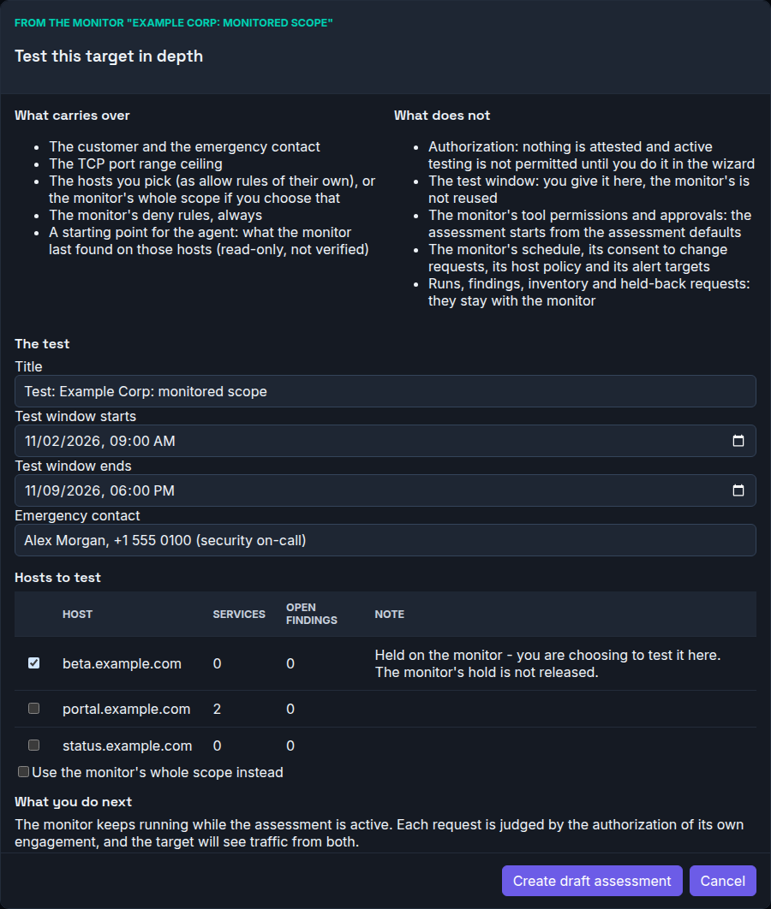
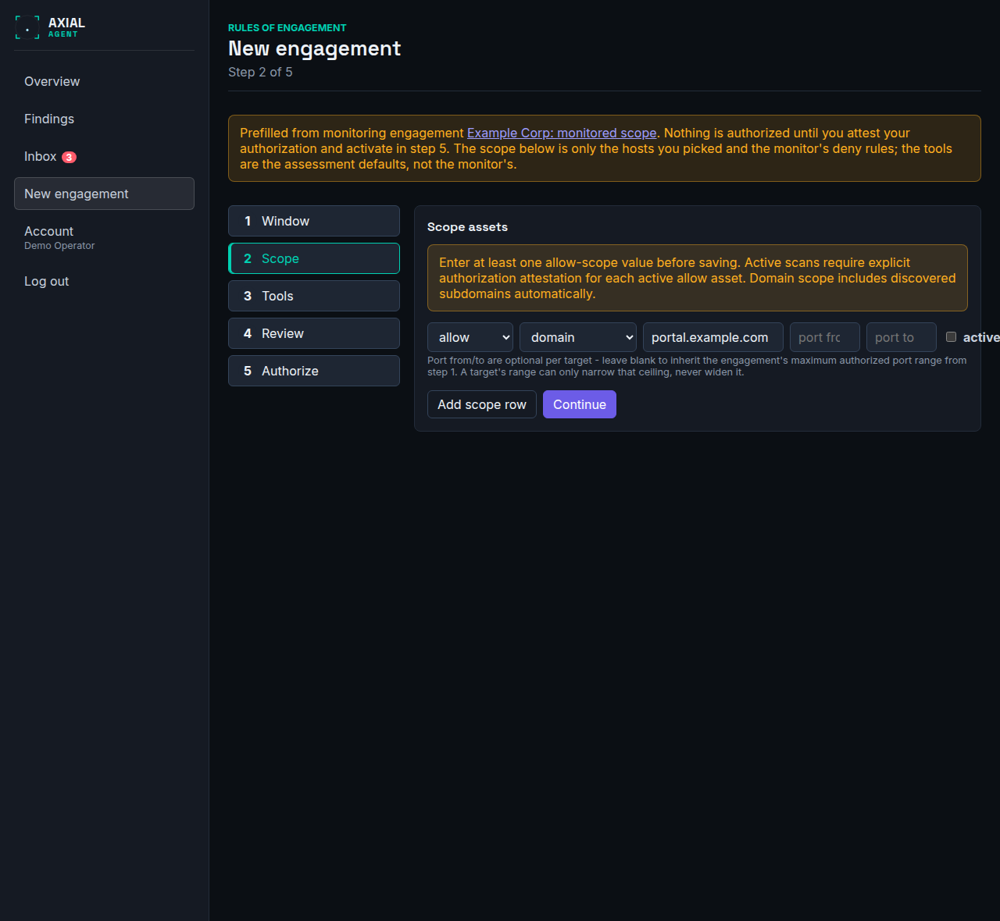

# Test a monitored target in depth

**Who this is for:** the owner of a monitoring engagement, or an administrator, who wants a person to test what the monitor watches more deeply.
**After this page you can:** start a draft assessment from a monitor, finish and activate it, and know what carries over from the monitor and what never does.

<!-- ui-labels: Test deeper | Test this target in depth | What carries over | What does not | Hosts to test | Use the monitor's whole scope instead | Create draft assessment | Assessments from this monitor | Follows monitoring engagement | Pause engagement -->

## The idea

A monitor is unattended and gentle by design: it never sends a request that changes data and it never waits for a person. A deeper test is the opposite use, with a person present, approvals, and the Vector Agent on. The two are separate engagements, because the mode of an engagement is fixed.

**Test deeper** on the monitor creates the second one for you. It fills in what the monitor already knows, links the two, and tells the assessment's agent what monitoring found, so the test starts from the known surface instead of from nothing. It **authorizes nothing**: you give the test window, attest your authorization and activate in the usual wizard, exactly as for any assessment. The monitor itself is not changed.

## Before you start

- You own the monitor, or you are an administrator. Anyone can read a monitor; only its owner or an administrator can start a deeper test from it.
- The monitor is **active** or **paused**. A draft, a closed monitor and a **revoked** one cannot start one: a withdrawn authorization must not seed a new engagement.
- It is a monitor of your own domain (or a lab). A monitor that belongs to a bug-bounty program cannot start one, because the program's rules are not carried over.
- The monitor has run at least once. The hosts you can pick, and what the agent is told, come from its last healthy run.

## Start it

1. Open the monitoring engagement and choose **Test deeper** in the **Controls** row.
2. The screen **Test this target in depth** lists **What carries over** and **What does not**. Read the second list: it is the part you have to do again.
3. Give the **Title** (it starts as "Test: " and the monitor's title), the **Test window starts** and **Test window ends** (both required, there is no default), and the **Emergency contact** (prefilled from the monitor).
4. Under **Hosts to test**, tick the hosts the test is for. The list shows, per host, how many services the monitor saw and how many findings are open. A host the monitor holds can be ticked, and the note says so: you are choosing to test it in the assessment, and the monitor's hold stays as it is. A host that one of the monitor's deny rules matches cannot be ticked.
5. Read the last block, which says whether the monitor can keep running while the assessment is active (see below). Then choose **Create draft assessment**.

If you would rather give the test the monitor's whole scope, tick **Use the monitor's whole scope instead** and confirm it. That copies every allow rule, subdomains included, which is usually more than a test needs.

## What carries over, and what never does

| Carries over (and you can change it in the wizard) | Never carries over |
|---|---|
| the customer, the emergency contact, the TCP port range | authorization: nothing is attested, and active testing is not permitted, until you do it in the wizard |
| the hosts you ticked, as allow rules of their own | the test window: the monitor's (often a year) is not reused |
| the monitor's **deny rules**, always, whatever you ticked | the monitor's tool permissions and approvals: the test starts from the assessment defaults |
| a starting depth of *Thorough* and the Vector Agent on | the schedule, the consent to change requests, the new-host policy and the alert targets |
| | runs, findings, the inventory and held-back requests: they stay with the monitor |

A deny rule always wins. If a host you ticked is matched by a deny rule of the monitor, nothing is created and you are told which host.

## Finish it in the wizard

The console opens the draft in the wizard, with a banner on every step saying where it came from and that nothing is authorized yet.

 Go through the steps as for any test: set the details of the window, **attest** your authorization for each host and allow active testing, choose the tools (the assessment defaults ask for your approval before a request that changes data, and before the heavier tools), and **Activate engagement**. See [Define an engagement and its scope](define-an-engagement.md) and [Authorize and activate](authorize-and-activate.md). Every rule of activation applies unchanged: the draft cannot be activated sooner or with less than any other assessment.

## Both at the same time

The monitor can keep running while the assessment is active when the installation requires the signed identity of each run, which is the default. Each request is then judged by the authorization of its own engagement, and the target sees traffic from both. Activating the assessment shows a note naming the monitor.

If your administrator switched that off, activating the assessment is **refused** while the monitor is active, because the platform could not tell the two apart. Use **Pause engagement** on the monitor first. Starting a deeper test never pauses the monitor for you.

## What the agent is told

When the assessment's agent starts, it also receives what the monitor last found, for the hosts of the assessment's own scope: the services and versions of the monitor's last healthy run and its open findings. The agent is told this is a claim of an earlier unattended run that is **not verified** here, to use it to decide where to look, and to confirm anything itself. It contains no evidence, no request or response and no credential, and nothing about a host that is not in the assessment's scope. It authorizes nothing: every action the agent proposes still passes the Scope Gateway for the assessment's own scope, window and approvals.

## Where to find it afterwards

The monitor's page lists **Assessments from this monitor**: title, status, owner and test window. The assessment's page says **Follows monitoring engagement** with a link back.

The two stay separate. Pausing, closing or revoking the monitor does not change the assessment, and the reverse. The assessment's findings are its own and appear on **Findings** under its own title; nothing is written back to the monitor, and a finding the assessment confirms is not marked on the monitor. If the monitor is deleted, the assessment stays and its link is empty.

## When it is refused

The refusals and what to do are in [Troubleshooting](../troubleshooting.md#test-deeper-starting-an-assessment-from-a-monitor).

## What is not in this version

- Skipping the assessment's own discovery because the monitor knows the hosts: the assessment discovers for itself.
- Picking individual monitor findings to confirm or refute.
- Starting one from an assessment, or into an assessment that exists.
- Naming the monitor on the authorization PDF.
