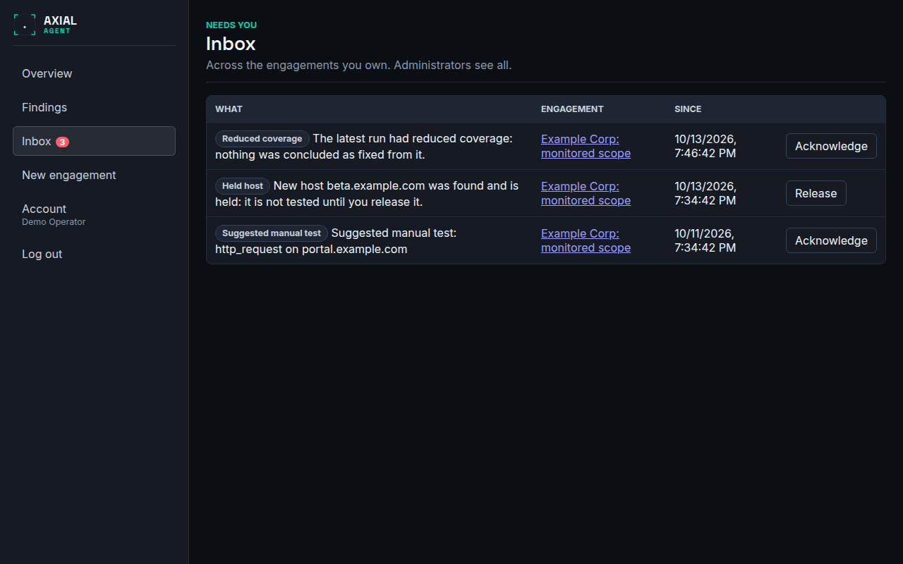

# Inbox

**Who this is for:** operators who own engagements, especially monitoring engagements, and administrators.
**After this page you can:** read every kind of item in the inbox, say what it means, and clear it the right way.

<!-- ui-labels: Inbox | Needs you | Release | Acknowledge | Open | Release all -->

## Inbox (`/inbox`)

Everything that needs a person, in one list. A monitoring run never waits for anyone, so what it could not decide for itself is left here. The list covers the engagements you own; an administrator sees all of them. The number of open items is shown next to **Inbox** in the navigation.

| Item | What it means | What to do |
|---|---|---|
| Approval needed | A call of a run that you started is waiting for your decision | **Open** the run and decide, see [Approve or deny a tool call](../guides/approve-or-deny-a-tool-call.md) |
| Review needed | The run is paused for the review of the discovered hosts | **Open** the run |
| A run is waiting for you | A semi-attended run parked because its agent needs a decision. It holds no worker slot and resumes by itself when you decide | **Open** the run and decide. It clears when the run resumes |
| Held host | A new host was found and is not tested until you release it | **Release** it, or **Release all** when there are several. It is tested from the next run |
| Suggested manual test | A run could not make a call because it would have needed a person's decision. It is kept here as a lead | Test it yourself, or **Acknowledge** it |
| Reduced coverage | A run finished but a load-bearing tool failed or a check stopped at its time limit, so nothing was concluded as fixed from it | Read the run, and run again |
| Run did not finish | A run failed or was stopped | Read the reason on the run, see [Troubleshooting](../troubleshooting.md#why-a-run-stopped) |
| Monitor went quiet | No healthy run finished for twice the expected time | Find out why; a healthy run clears it |
| Authorization review | The review date of the standing authorization is near | Re-attest, then move the review date on the edit page |

**Release** and **Acknowledge** are for the engagement's owner and for administrators. Acknowledging an item does not change scope, tool grants or any setting; it only says that you have seen it, and for a held host, that it may be tested.
